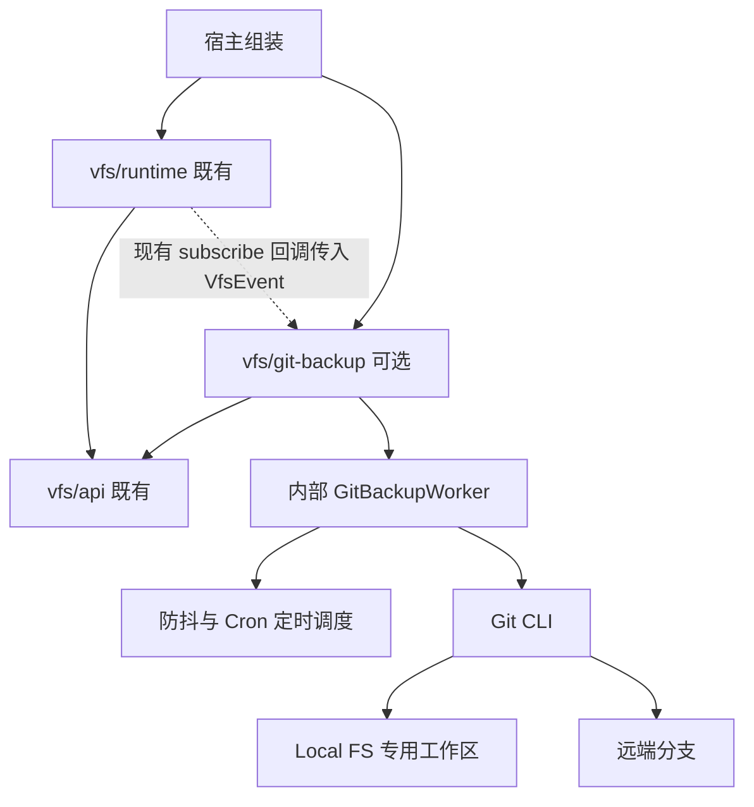
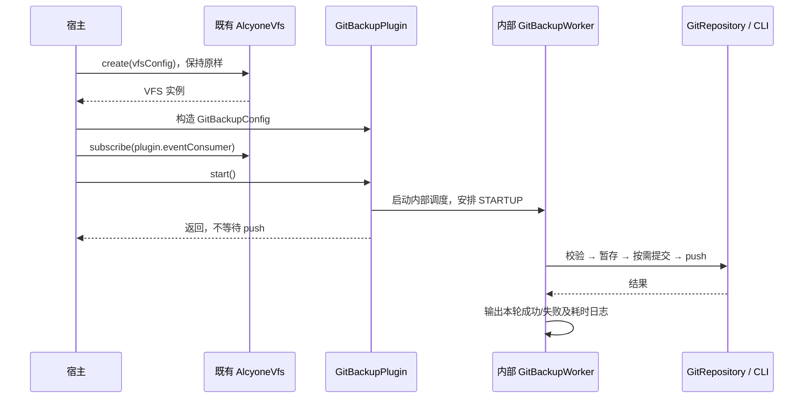
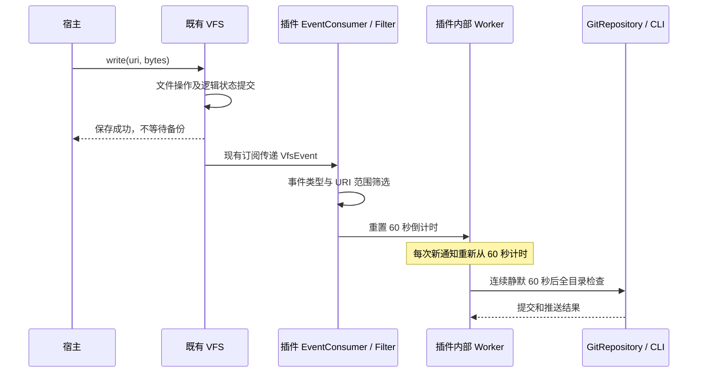

# Git 本地目录备份设计 v0.1

## 本次修改（2026-10-16，用户授权启动 E1）

- 用户已授权开工，建立 [E1 里程碑与 T33～T36 任务](../tasks/e1-git-backup/E1_Git本地备份里程碑.md)，当前 T33 IN_PROGRESS，T34～T36 TODO；此前“仅设计/未启动”表述为历史状态。
- Architect 通过 Paseo 协调 Lead → Worker，逐任务初验和独立复核后继续；用户已授权常规推进，无需重复确认。不扩大范围、不发布真实远端。涉及当前安排、任务入口与协作规则。

## 本次修改（2026-10-16，Cron 与日志简化）

- 按用户要求用五字段 Cron 替代 dailyAt，统一采用本机时间，删除 zoneId 配置和专门的时区处理设计。
- 删除公开 GitBackupStatus、状态查询和请求结果枚举；每次同步记录开始和成功/失败结果，宿主无需管理同步状态。插件只保留内部防抖、串行执行及资源启动/关闭逻辑。
- 更新配置、接口、用例流程、类目录和验收方向，涉及第 1～9 节；本轮仅文档，不启动实现。以下旧设计以本轮正文为准。

## 历史修改（2026-10-15，独立插件化修订）

- 按用户要求取消 Runtime 配置、公开方法、组装和关闭流程的修改；插件仅依赖 VFS API，由宿主通过现有 `subscribe` 接线，全部计时和 Git 操作归插件内部。
- 改为每个工作区一个 `GitBackupPlugin`：独立配置物理根与逻辑事件范围，独立启动/关闭和状态查询；补充无取消订阅句柄时的关闭边界。重写第 2～4、6～8 节并同步其他相关说明。
- 本轮仍仅设计修订，未创建模块或修改任何生产代码；以下首轮设计说明作为历史记录，其 Runtime 接线方案已被本文正文替代。

## 历史修改（2026-10-15，首版设计草案）

- 根据用户确认的范围，设计本地 Mount 根目录的单向 Git 备份：60 秒静默防抖、每日定时、启动检查和手动触发；不实现消费位点、事件重放、自动冲突处理或 `.git` 保护。
- 细化新增模块、Runtime 接线、配置和类职责、主要用例与模块调用流程、目录布局及验收方向，涉及全文。
- 本文为待讨论的设计草案；用户已确认的需求与本文建议的实现细节分别标明。本轮仅编写文档，不创建模块、不启动开发、不执行真实远端推送。

## 1. 目标与范围

### 1.1 已确认的需求

本地 Mount 根目录直接作为专用 Git 工作区，使用 Git 保存文件历史并单向推送远端。文件保存与 Git 备份独立，Git 失败不回滚或改变已完成的 VFS 文件操作。

| 项目 | 首版规则 |
| --- | --- |
| 备份源 | 已配置的 Local FS Mount 的整个物理根目录，不包含 WebDAV，不做跨 Mount 文件聚合 |
| 事件触发 | 每次相关文件变更通知把倒计时重新设置为 60 秒；连续静默 60 秒后请求同步 |
| Cron 定时兜底 | 按 Cron 配置和本机时间检查整个工作区，默认每天凌晨 03:00，不依赖是否收到通知 |
| 启动检查 | 插件启动后异步请求一次完整检查，补足离线期间或错过 Cron 定时任务的变更 |
| 手动触发 | 宿主可请求立即检查，不等待防抖倒计时 |
| 同步方向 | 本地提交并 push 到一个远端分支；不 pull、不 merge/rebase、不 force push |
| 失败处理 | 记录失败，等待后续事件、Cron 定时任务、手动或下次启动触发；不建独立重试调度 |
| `.git` | 不增加隐藏、路径保护、递归拦截或相关 VFS 规则；调用方自行避免破坏仓库 |

连续写入会持续重置倒计时，可能一直不发生事件触发的同步；Cron 定时和手动触发独立于此计时。60 秒是静默触发间隔，不是 Git 操作完成时限，已有同步在执行时需要串行等待。

### 1.2 备份保证与排除项

每次同步检查 Git 工作区的当前内容，不从事件重建文件，也不保证保留每次写入的中间版本。例如文件两次修改发生在一次暂存之前，只备份暂存时读到的版本。

- 新增、修改、删除均纳入提交；删除后旧内容仍在已有 Git 历史中。空目录、符号链接等沿用 Git 自身表示，不跟随链接备份其目标目录。
- `.gitignore` 决定未跟踪文件的排除；已跟踪文件不会因为后来加入忽略规则而自动停止跟踪。不用强制添加绕过忽略规则。
- 这里只备份目录文件，不备份 VFS SQLite、Node 身份和数据库 Metadata，不能替代完整 VFS 冷备恢复。
- 不引入数据库表、持久化任务队列、消费游标、可靠投递、重放、自动修复仓库、自动初始化远端或历史清理。
- 不保证在磁盘故障、一直无法 push 或进程一直离线时远端必有最新数据；定时检查覆盖仍留在工作区的变更。

### 1.3 工作区前提

建议首版要求宿主预先初始化普通 Git 仓库，配置提交身份、remote、认证和当前分支；不支持 bare 仓库作为源、linked worktree、子模块或嵌套仓库。空的初始分支可以使用，不要求先手工创建首个提交。

工作区根必须与 Local FS 真实根相等，不能只是更大仓库的子目录。目录专供该 Worker 管理暂存和提交，宿主不并行执行 Git 命令、切换分支或重写历史；同一物理目录不得由其他插件实例/进程同时备份，首版不增加跨进程调度锁。

逻辑子 Mount 不会被导出进父目录仓库。Git 备份的是物理根中实际存在且未被忽略的内容，包括未通过 VFS 写入的文件，不是 VFS 合并后的逻辑目录视图。

## 2. 现有代码基线与模块划分

### 2.1 可行性与改动边界

现有 [AlcyoneVfs.subscribe](../../vfs/runtime/src/main/kotlin/com/github/noahshen/alcyone/context/vfs/runtime/AlcyoneVfs.kt) 已接受 `(VfsEvent) -> Unit`，足以接入普通文件变更 Consumer。[VfsEvent](../../vfs/api/src/main/kotlin/com/github/noahshen/alcyone/context/vfs/VfsEvent.kt) 已包含事件类型、逻辑 URI，以及移动的源/目标 URI，不必扩充事件。

插件只需物理目录用于 Git 操作、逻辑 URI 范围用于事件筛选，不需要 Runtime 内部的 MountRouter、Storage、Repository 或配置解析结果。两者由宿主在组装处使用同一份目录配置提供，插件不从运行中的 VFS 反查物理路径。

**设计目标：现有 VFS API、Core、Storage、Persistence、Runtime 的生产代码和 Runtime 构建依赖均零改动。** 新增插件模块、测试与必要的根构建登记，宿主自行选择是否引入插件；“插件”表示普通可选 JVM 组件，不建立动态加载框架。

### 2.2 新增一个可选生产模块

新增 Gradle 模块 **`:vfs:git-backup`**，目录 `vfs/git-backup/`。一个公开 `GitBackupPlugin` 管理一个专用工作区，内部拥有一个 Worker；多个工作区由宿主分别创建实例，不再增加服务管理层。



实线表示构建依赖或组件调用，虚线仅表示宿主注册后的事件传递，不代表 Runtime 依赖插件。

- 插件直接依赖 `vfs/api`、Coroutines 和 SLF4J API，使用 JDK 时间/进程 API，不依赖 Runtime/Core/Storage/Persistence。
- 既有 Runtime 不依赖插件；只使用 VFS 的宿主不会传递引入 Git 模块，也无需安装 Git。
- 插件不实现 Storage Port、不调用 VFS 文件操作、不写 VFS 状态库。Git 的调度和失败不进入 VFS 事务或关闭流程。
- 测试可组合 Runtime，但插件生产源码不可通过测试依赖反向引用 Runtime。

### 2.3 构建、发布和验证入口

实施时在 `settings.gradle.kts` 登记模块，在根发布映射增加可选产物 `alcyone-vfs-git-backup`。原六模块 SDK 依赖链保持；需要备份的消费工程显式增加插件坐标，产物总数可为七个，不把插件变成 Runtime 的必需依赖。

集成测试复用 `integration-tests/vfs`，仅增加 `testImplementation(project(":vfs:git-backup"))` 与插件用例。独立消费验证保留“只依赖 Runtime”的基线，再增加显式依赖插件的可选验证场景；不要求原消费样例默认创建或运行插件。

Git 本地 bare remote 测试纳入常规检查，缺少 Git 时清晰失败、不静默跳过，并归档测试所用 Git 版本。插件测试所需依赖统一在 Version Catalog 声明，产品运行时只有启用插件才要求 Git。

## 3. 独立配置与宿主接口草案

以下名称和默认值是建议接口，尚未实现。`VfsRuntimeConfig` 和 `AlcyoneVfs` 均不增加 Git 字段或方法，宿主只负责插件配置、启动、手动触发和最终关闭，不查询或管理每次同步的状态。

### 3.1 每个插件一个工作区

| GitBackupConfig 字段 | 建议值/类型 | 规则 |
| --- | --- | --- |
| `repositoryRoot` | 必填 Path | 专用本地工作区根；宿主复用配置 Local FS Mount 的同一个 Path，插件自行规范化 |
| `eventRoots` | 必填非空 Set<VfsUri> | 会影响该工作区的逻辑 Mount 根；同一物理目录有多个逻辑别名时全部列入 |
| `remoteName` | `origin` | 已配置的 remote 名称，不接受 URL 参数；限定一个有效推送目标 |
| `branch` | 必填 String | 当前本地分支与目标远端分支同名，不自动切换或创建本地分支 |
| `quietPeriod` | 60 秒 | 正时长，每次相关通知重置 |
| `cron` | String，`0 3 * * *` | 五字段表达式，按本机时间解释；可调整频率，不提供时区字段 |
| `gitExecutable` | `git` | 程序名或路径，不接受拼接的 shell 命令 |
| `localCommandTimeout` | 30 秒 | 单次本地校验、暂存、提交命令的超时 |
| `pushTimeout` | 120 秒 | 单次推送超时，不含排队时间 |
| `shutdownGracePeriod` | 10 秒 | 关闭插件时给当前任务的等待期 |

默认每天 03:00 和超时数值是工程默认建议，不是已验证的性能保证。插件不知道 VFS 的完整挂载表，不能宣称自己验证了“目录一定属于某个 Local FS Mount”；这项对应关系由宿主保证，接入示例必须复用同一份路径变量。

### 3.2 接入与资源释放

```kotlin
// 设计伪代码：vfsConfig 已使用 localRoot 作为该 Mount 的物理根。
val vfs = AlcyoneVfs.create(vfsConfig)
try {
    val backup = GitBackupPlugin(
        GitBackupConfig(
            repositoryRoot = localRoot,
            eventRoots = setOf(VfsUri.parse("alcyone://resources/notes/")),
            branch = "main",
            cron = "0 3 * * *",
        ),
    )
    try {
        vfs.subscribe(backup.eventConsumer)  // 唯一的事件接线，既有 API
        backup.start()                      // 插件内部启动首次检查、Cron 定时和防抖调度
        // 宿主继续正常使用 vfs；需要时 backup.requestSync()，执行结果写日志
    } finally {
        backup.close()                      // suspend；只关闭插件，不关闭 VFS
    }
} finally {
    vfs.close()                              // 既有关闭逻辑，不调用插件
}
```

构造只检查参数和建立轻量对象，不启动计时/进程；`start()` 不等待 Git 成功，重复调用幂等，关闭后不允许重启同一实例。先注册再 start，注册窗口收到的通知可在内存合并，启动完整检查会覆盖窗口内的当前内容。

插件创建/参数错误由宿主处理；Git 不存在、目录不可用或仓库校验失败记录错误日志，不影响已创建的 VFS。若宿主选择在插件配置错误时仍运行 VFS，由宿主捕获该错误，不把这个策略放进 Runtime。进程资源仅在 start 后取得，start 中途失败要释放已经取得的资源。

### 3.3 现有订阅没有取消句柄的处理

`AlcyoneVfs.subscribe` 返回 Unit，没有公开 unsubscribe；本版接受这个边界，不访问内部 notifier，也不修改 VFS 订阅契约。

插件提供一个稳定的 `eventConsumer: (VfsEvent) -> Unit`。该回调是插件内的轻量桥接对象，只通过可清空引用转发到 Worker；close 先断开引用并关闭 Worker 的接纳入口，再停止调度/清理进程。即使并发回调已取到旧引用，Worker 也会拒绝 closing 后的新工作。

回调仍登记在 VFS 内，但关闭后立即无操作返回，不应继续持有 Worker、调度资源或进程。宿主使用上面的 `vfs.subscribe(backup.eventConsumer)`，避免以额外 lambda 捕获整个插件；同一插件只注册一次，不承诺在长寿命 VFS 上反复热装卸而不积累回调。插件停止不等于物理取消订阅，也不能承诺 VFS.close 自动关闭插件。

### 3.4 发起同步与执行日志

```kotlin
// 全部属于 GitBackupPlugin 草案，不属于 VFS API。
val eventConsumer: (VfsEvent) -> Unit
fun start()
fun requestSync()       // Unit，仅发起/合并请求，不等待 Git 执行完毕
suspend fun close()
```

不提供 status()、GitBackupStatus 或请求结果枚举。启动后请求一次流程，插件负责完整执行并写日志；运行中请求合并为至多一次后续检查。未启动或已关闭时手动调用 requestSync 属于调用错误，抛 IllegalStateException；关闭后的事件回调仍按第 3.3 节无操作返回。

每次实际执行分配仅用于日志关联的 runId，至少记录一条开始和一条结束日志。开始包含触发原因（EVENT / CRON / STARTUP / MANUAL）；成功记录提交 SHA（有则记录）、是否新建提交、是否完成 push 和耗时；无内容可提交或推送时明确记录跳过，失败记录阶段、退出码/超时和安全摘要，取消记录取消结果。

日志使用 SLF4J API，由宿主提供日志实现和文件留存/轮转策略；插件不另建日志数据库或保存“最近一次状态”。“持续记录”指每轮都输出结果，不代表在硬崩溃时保证结束日志落盘；正常失败也不得吞掉后不留记录。

仍需在内部记住“是否正在执行、是否有待执行请求、是否关闭”等少量标记，避免并行 Git 命令和关闭后继续运行。这些是资源控制的实现细节，不暴露生命周期状态机或要求宿主推进状态。

## 4. 调度模型与事件范围

### 4.1 事件只传递变更信号

插件内 `GitBackupEventConsumer` 接收 VfsEvent，通过 `GitBackupEventFilter` 判断事件 URI 是否位于 eventRoots 下。回调只筛选事件、更新内存计时并唤醒 Worker，不访问磁盘、不执行 Git、不等待同步结果。

| 事件 | 匹配规则 |
| --- | --- |
| FILE_CREATED、FILE_WRITTEN、FILE_DELETED、DIRECTORY_DELETED | event.uri 命中任一 eventRoot 就触发该实例 |
| FILE_MOVED、DIRECTORY_MOVED | sourceUri 或 targetUri 命中即触发，同一事件对该实例最多重置一次 |
| METADATA_UPDATED | 忽略，数据库 Metadata 不属于文件备份 |

比较使用 VfsUri 已解析的完整路径段，保留大小写；不能用字符串 startsWith。`/resources/notes` 匹配其子路径，但不匹配 `/resources/notes-old`；别名通过多个 eventRoots 表达，插件不重建完整 Mount 路由。

**有意接受保守的多触发：** 若 eventRoot 下还存在逻辑子 Mount，其事件也可能重置父目录插件的倒计时。这只会让父物理目录多检查一次或推迟其静默检查，不会读取/备份子 Mount 的远端内容；Cron 定时触发不受此影响。第一版不为过滤这种额外通知引入 Core 依赖或复制路由算法。

目录根级事件足以触发全工作区检查；当前没有公开的独立目录创建事件，不新增事件类型。跨本地 A/B 移动时，两实例分别匹配源/目标；移往 WebDAV 时只有源本地实例匹配。失败操作没有成功事件也可能留下物理变化，由 Cron 定时/启动检查按真实目录内容处理，不修复逻辑状态。

### 4.2 每个仓库一个串行 Worker

一个 `GitBackupPlugin` 拥有一个 `GitBackupWorker`，多个仓库由宿主创建多个独立插件；每个 Worker 最多同时运行一个 Git 流程。内存只保留最新通知时间、变更代数和一个待立即执行标记，不保存逐条事件队列。

短临界区内更新这些字段，之后通过合并唤醒信号唤醒 Worker；不能只把事件放入可能丢失“最后一次重置”的满队列。Git I/O 在临界区之外执行，通知与手动请求不会被它阻塞。

| 触发 | 空闲时 | 正在同步时 |
| --- | --- | --- |
| 相关事件 | 重置为完整 quietPeriod | 同样重置，保留本轮开始后发生的新变更 |
| Cron 定时/手动/启动 | 立即安排完整检查 | 合并成一个后续立即检查请求 |
| 关闭 | 停止接收请求和计时 | 等待宽限期，之后取消并清理本服务启动的进程 |

每次开始同步时，原子取得本轮变更代数并消费已有请求，清掉本轮之前的静默定时。同步结束只结清本轮取得的代数，不清掉运行期间的新通知；新通知已静默 60 秒则立即补一轮，否则等其剩余倒计时。

例如：第 0 秒收到通知，第 30 秒再次收到通知，倒计时重置为 60 秒，第 90 秒才触发。若同步在第 100 秒仍执行，新通知不会启动第二个并行 Git 进程。

### 4.3 Cron 定时与本机时间

Cron 采用五字段格式 `分 时 日 月 星期`，不含秒或年份。支持 `*`、数字、范围、列表和步长；分钟 0～59、小时 0～23、日 1～31、月 1～12、星期 0～6（0 为周日），日与星期同时限定时按任一满足触发；首版不支持 Quartz 的 `? / L / W / #` 或宏别名。

| cron 示例 | 含义 |
| --- | --- |
| `0 3 * * *` | 每天凌晨 03:00，默认 |
| `*/30 * * * *` | 每小时的第 0、30 分钟 |
| `0 */2 * * *` | 每天 00:00、02:00、04:00 等偶数整点 |
| `0 3 * * 1` | 每周一凌晨 03:00 |

插件构造时校验表达式、范围及是否存在未来匹配时刻，非法配置直接报参数错误，不静默退回默认。表达式使用本机系统时间解释，不提供 zoneId、不引入跨时区调度需求；更换 cron 配置后重新创建插件生效，首版不提供热更新接口。

`CronBackupSchedule` 是插件内部的小型适配类，只负责表达式校验和下一次触发计算，不新增通用调度框架。采用与上述语义一致的解析实现，具体依赖在开发任务中核对并放入 Version Catalog；不能无说明地使用不同 Cron 方言。

每个有效调度时刻最多提交一次触发请求，定时触发不等待静默期。宿主休眠跨过多个调度时刻后只补一次检查，再计算下个未来时刻，不积压补跑；插件未运行期间由启动检查兜底。时间跳变后重新计算未来触发，不建立完整的时区/夏令时专用策略。

防抖仍使用单调时间，与 Cron 的本机日历时间分开；计时器醒来后在短临界区核对最新变更代数和剩余时间，防止通知刚重置倒计时就被旧计时器提前触发。

## 5. Git 执行流程与失败边界

### 5.1 单次完整同步

`GitBackupWorker → GitRepository → GitProcessRunner → Git CLI`，所有命令固定以已解析工作区根为 cwd，按顺序完成：

1. **VALIDATE**：确认普通仓库根与配置的 repositoryRoot 完全相同，当前分支正确、非 detached HEAD、身份/remote 可用，没有未解决合并或进行中的 merge/rebase 等状态；嵌套仓库/子模块不支持，暂存前报错，不自动修复。
2. **STAGE**：对整个根目录执行等价于 `git add -A -- .` 的操作，收录删除并遵守忽略规则。不是按事件里列出的文件逐个添加。
3. **COMMIT**：检查 index 相对 HEAD 的差异；尚无 HEAD 时按首次提交处理。有差异则创建普通提交，无差异跳过提交，不生成空提交，不 amend。
4. **PUSH**：存在 HEAD 时，将当前本地 HEAD 推到明确指定的 remote 和 `refs/heads/<branch>`，不依赖默认 push 分支，不带 force。即使本轮无文件差异，也执行 push，以补足之前未成功的提交。
5. **RESULT**：仅 push 返回成功后记录推送成功日志；初始仓库完全没有可提交内容且无 HEAD 时记录无内容跳过，不宣称已推送。

提交信息建议使用 `Backup <本机日期时间>`。远端可能已收到了提交但本地响应失败，此时如实报告失败/结果未确认，下次正常 push 再核对，不做破坏性补偿。

### 5.2 不锁住 VFS 文件写入

暂存和提交不持有 VFS 的状态事务锁，不暂停文件操作；快照可能包含多个写入时刻的内容，不保证业务多文件原子一致。例如某文件在暂存完成后再被写入，本次提交保留已暂存版本，下一轮检查再收录后续内容。

Worker 不按通知数决定“是否需要 push”，也不通过清理工作区回滚失败。失败留下的 index、本地 commit 和文件均保留，由下一次完整暂存检查处理；不执行 reset --hard、clean、删锁文件或强推。

### 5.3 子进程与日志

`GitProcessRunner` 使用参数数组启动进程，不拼接 shell；校验分支和 remote 参数，清除会重定向目标仓库/index 的 Git 环境变量，再显式传 cwd。保留宿主正常身份和认证配置，禁用 Git 终端提问及 SSH 交互，credential helper/其他外部程序也受整体命令超时约束。

输出需要并发排空并限制保留大小，不能先无界读取 stdout 再开始计时。命令超时/取消后，仅清理本服务创建的进程及可追踪子进程，有限等待并确认退出；无法确认清理时阻止该 Worker 启动新的命令并记录清理失败，不能声称强杀必定成功或按进程名全局清理。

日志只记录插件实例标识、阶段、退出码/超时、耗时和安全错误摘要；不默认输出 remote URL、环境、完整命令输出或异常全文。Git 输出可能含凭据，不能直接记录原始 stderr。仓库 hooks/过滤器属于宿主受信配置，不新增其管理系统，挂起和报错按同一命令边界处理。

## 6. 主要用例与模块调用流程

### UC-G01：宿主启用插件与启动检查

前置：宿主准备好专用仓库，并给插件传入与本地 Mount 相同的物理根和对应逻辑 URI。宿主先创建既有 VFS，再独立构造插件、注册 Consumer、start；Git 的环境校验在插件后台执行，不进入 VFS 创建流程。



首次 Git 校验失败不会撤销 VFS。宿主修正环境后通过 requestSync 或 Cron 定时任务再检查；不增加 VFS 错误类型。

### UC-G02：文件变更与 60 秒防抖



图中保存返回与异步 Consumer 的先后不作保证；通知发生在逻辑事务提交后。VFS 只调用已有 Consumer，既不知道 Git，也不等待 Git。

### UC-G03：移动与删除

`VFS 既有事件 → 各插件 Consumer → URI Filter → 各自 Worker → 完整暂存 → commit/push`。移动同时匹配 sourceUri/targetUri，同一插件最多重置一次；跨工作区生成各自的删除/新增历史，不要求仓库之间原子提交。

纯 Metadata 和完全位于 eventRoots 之外的事件不能重置计时；逻辑子 Mount 的保守多触发按第 4.1 节验收，不误称为精确路由。

### UC-G04：Cron 定时兜底与漏通知

`Worker 内的 CronBackupSchedule → 同一 Worker 的立即请求 → GitRepository 全目录检查 → GitProcessRunner`。Cron 定时任务不读取 VFS，也不需要 VFS 产生事件；只要插件在运行，宿主未做 VFS 操作也能备份外部物理修改。

用不经过 VFS 的物理文件新增/修改/删除验证 Cron 定时兜底，启动检查补足插件未运行期间的当前内容；不逐条恢复中间版本。

### UC-G05：手动触发与运行中变更

`宿主 backup.requestSync() → Worker 合并立即请求 → 立即返回 Unit`，实际执行结束时写日志。运行中新通知保留新一轮倒计时，不开第二个并行命令；多个手动/Cron 定时请求合并为至多一次后续检查。

### UC-G06：commit 成功但 push 失败

`GitRepository commit 成功 → push 失败 → Worker 记录 FAILED/PUSH`。下一次触发即使无文件差异也再次 push，不重复创建空提交、不自动强推或拉取；失败处理留在插件并写日志，无公开状态模型。

### UC-G07：独立关闭与宿主退出

`宿主停止提交业务工作 → backup.close() → vfs.close()`，各资源在嵌套 finally 中分别释放，插件关闭抛错也必须继续尝试 VFS.close。插件先断开 Consumer 引用并拒绝新请求，再停止 Cron 定时/防抖任务，等待当前 Git 宽限期，必要时取消并清理自己的子进程；不追加退出前 push。

插件关闭后，VFS 可以继续单独使用；其事件送到残留轻量回调时立即返回。反过来只关闭 VFS 不会关闭插件，插件 Cron 定时任务仍可能运行，因此宿主必须负责二者的生命周期。先关闭插件也避免既有 WebDAV 无界等待阻止 Git 清理，VFS 本身的方案④边界不变。

## 7. 类与代码目录设计

公共包前缀沿用 `com.github.noahshen.alcyone.context`。以下为计划文件，不提前创建；小型结果类型可以合并在所属文件。所有插件生产类都在新增模块，不再往 Runtime 放桥接类或 Git 配置。

```text
vfs/git-backup/
  build.gradle.kts
  src/main/kotlin/com/github/noahshen/alcyone/context/vfs/gitbackup/
    GitBackupPlugin.kt                 # 独立公开入口，一实例一仓库
    GitBackupConfig.kt                 # 物理根、事件范围和 Git/调度参数
    internal/
      GitBackupEventConsumer.kt        # 稳定回调，close 清空 Worker 引用
      GitBackupEventFilter.kt          # VfsEvent 类型与完整路径段筛选
      GitBackupWorker.kt               # 串行流程、倒计时、Cron 定时任务、执行日志
      CronBackupSchedule.kt           # Cron 校验与本机时间下次触发计算
      GitRepository.kt                 # Git 命令业务序列
      GitProcessRunner.kt              # 内部进程执行契约
      JvmGitProcessRunner.kt           # ProcessBuilder、超时与输出处理
  src/test/kotlin/.../gitbackup/
    GitBackupPluginTest.kt             # 创建、接纳、关闭、资源释放
    GitBackupEventFilterTest.kt
    GitBackupWorkerTest.kt
    CronBackupScheduleTest.kt
    GitRepositoryTest.kt
    JvmGitProcessRunnerTest.kt

integration-tests/vfs/
  build.gradle.kts                     # 仅新增插件 testImplementation
  src/test/kotlin/.../vfs/integration/gitbackup/
    GitBackupSubscriptionTest.kt       # 宿主按已有 subscribe 接线
    GitBackupFailureTest.kt            # 本地 bare remote、失败与再触发

settings.gradle.kts                    # 登记可选模块
build.gradle.kts                       # 增加可选产物发布映射
# vfs/runtime 及其他既有生产模块的源码/依赖不改动
```

| 类 | 主要职责 | 边界 |
| --- | --- | --- |
| GitBackupPlugin | eventConsumer、start、requestSync、close | 公共宿主入口，不持有 VFS，不创建 Runtime |
| GitBackupConfig | repositoryRoot、eventRoots、调度与命令参数 | 公共，不引用 MountConfig/ResolvedConfig 或密码 |
| GitBackupEventConsumer | 将事件转交 Worker，close 时可断开 | internal，不捕获整个插件；回调不会做 IO |
| GitBackupEventFilter | 事件类型/路径段判定 | internal，只依赖 VfsEvent/VfsUri，不实现 MountRouter |
| GitBackupWorker | 收信号、重置计时、Cron 定时触发、串行执行与日志 | internal，每仓库一个，不存事件内容 |
| CronBackupSchedule | 计算下次 Cron 触发时间和补一次规则 | internal 纯逻辑，可注入 Clock |
| GitRepository | 校验仓库、stage、按需 commit、push | internal，不调用 VFS，不读数据库 |
| GitProcessRunner / JvmGitProcessRunner | 进程执行边界及 JDK 实现 | internal，不建通用进程框架；IO 排空、超时和清理 |

插件使用私有 CoroutineScope 管理自身任务，不使用 GlobalScope，不把异常传播到宿主 Job。close 的资源清理在调用方取消时仍须执行；有限等待与进程退出检查由插件自身负责。构造不启动任务，start/close 状态转换须防并发；正常操作失败写日志，取消必须走进程清理，不能吞掉 CancellationException 后继续执行下一条 Git 命令。

## 8. 验收设计与后续任务边界

### 8.1 核心验收用例

| 编号 | 可观察结果 |
| --- | --- |
| G01 配置/启动 | 不引入插件时 VFS 不依赖 Git；插件参数校验、异步启动、重复 start/close；构建依赖确认插件只引用 API，Runtime 不引入插件；缺 Git/目录/仓库配置错误不破坏 VFS |
| G02 防抖 | 第 0 秒通知、第 30 秒通知，第 89 秒未开始、第 90 秒开始；持续通知持续重置 |
| G03 事件范围 | 普通变更、删除、移动双侧、同实例去重、URI 别名、完整段边界、子 Mount 保守多触发和 Metadata 忽略均有断言 |
| G04 Cron 定时/启动 | 无通知的物理变更被发现；启动补检查；五字段解析与分钟/小时/星期频率符合配置，本机时间和休眠补一次不积压任务 |
| G05 内容/首次提交 | 新增、覆盖、删除、忽略文件、空初始仓库、无差异跳过 commit；核对 bare remote 提交树与文件内容 |
| G06 推送补足 | push 失败保留本地提交；无新差异时下一次仍 push；无空提交，不强推、不拉取 |
| G07 并发/合并 | 单仓库最大并发命令流程为 1；手动/Cron 定时合并；运行期间新通知不丢；不同仓库失败隔离 |
| G08 进程/关闭 | 输出充满管道、大输出截断、挂起子进程、超时、取消、关闭均有可控装置；清理只作用于自建进程 |
| G09 执行日志 | 每次实际运行有开始/结束日志，区分成功、无内容、失败与取消，关联 runId；push 失败不记成功，摘要不泄漏测试凭据 |
| G10 集成/交付 | 仅靠既有 subscribe 接入；插件关闭后 VFS 可继续用，回调不再持有 Worker；插件重开发现未提交文件；原 Runtime 消费链与可选插件消费分别验证 |

调度测试使用受控单调时间与日历 Clock，不等真实 60 秒或凌晨；Git 集成用临时源仓库和本地 bare remote，隔离测试 Git 身份/配置，不修改用户 Git 全局配置。输出/超时与取消测试须断言进程实际结束，不能只断言协程结束。

### 8.2 正式任务映射（2026-10-16 已启动）

| 顺序 | 范围 | 交付与复核重点 |
| --- | --- | --- |
| 1 | 模块、配置与结果契约 | 新模块依赖、公开/内部边界、配置边界、Cron 方言与日志约定 |
| 2 | Git CLI 执行与仓库流程 | 本地真实仓库提交/推送、首次提交、失败保留、进程超时/清理 |
| 3 | 防抖与 Cron 定时调度 | 受控时间、请求合并、运行中新变更、关闭与执行日志 |
| 4 | 宿主订阅接线与可选插件交付 | 既有 API 零改动接入、独立资源释放、完整用例、可选产物和独立消费 |

用户已授权启动，上表顺序对应 [正式里程碑](../tasks/e1-git-backup/E1_Git本地备份里程碑.md) 的 T33～T36。Architect 通过 Paseo 管理一个 Lead，Lead 再委派 Worker；每项须先 Lead 初验、再由 Architect 独立复核，通过才继续。当前执行 T33，不提前实现后续空壳接口。

## 9. 与既有规划的关系

原规划中“由 Runtime 配置和组装 Git Worker”的安排以本轮用户要求为准，改为宿主通过现有订阅接口连接独立插件，Runtime 不增加 Git 依赖或功能。E01～E03 保留 Git 扩展的规划位置，但 E02 原“持久化消费进度/不遗漏事件”要求按本次用户决定取消，改为 Cron 定时和启动时检查当前工作区。E05 可靠消费保持独立 BACKLOG，不是本版前置；E04 崩溃恢复和 E08 WebDAV 原生超时也不随本版展开。

M0～M6/T01～T32 已交付状态不变，现有 752/43 与独立消费是旧版验收证据，不代表本设计已实现或通过测试。扩展完成时以新增用例后的实际计数和独立证据验收，不冻结历史计数。
